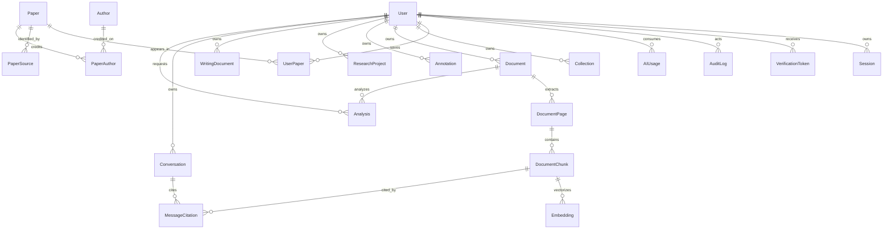

# ResearchNest v2 Database Design

## Principles

PostgreSQL is the durable system of record. SQLAlchemy 2.0 typed mappings describe application persistence and Alembic owns schema evolution. The schema separates globally reusable academic metadata, user-private research state, and the shared AI/RAG processing index. Shared infrastructure never implies shared tenant visibility.

Every private record and every derived retrieval record must have a verifiable ownership path. Use foreign keys, uniqueness rules, cascade behavior chosen per retention requirements, and indexes that support both tenant filtering and common lookups. Do not use a client-provided `user_id` as authorization evidence.

## Three-tier ER overview

`PaperAuthor` is the relational many-to-many association between papers and authors. A conversation owns its ordered message records (whether represented as child rows or an explicitly modeled message collection is an implementation decision); `MessageCitation` must identify its conversation/message and the authorized source chunk. Each private/index relationship must be protected with owner-aware queries even when the ERD omits repetitive `user_id` edges for readability.

## Tier 1: Global academic metadata

| Entity | Purpose and key relationships |
|---|---|
| `Paper` | Canonical scholarly work and globally reusable academic metadata. Use a stable internal ID and nullable provider identifiers such as DOI/arXiv ID with appropriate uniqueness constraints. It contains no private notes, collection state, or owner-specific flags. |
| `Author` | Canonical author identity and public metadata. Avoid merging people solely by display-name equality. |
| `PaperSource` | Provider/source records and source-specific identifiers, provenance, retrieval/update timestamps, and source metadata associated with a `Paper`. |
| `PaperAuthor` | Association rows linking `Paper` and `Author`, with ordering/role metadata as needed. |

Global metadata may be visible to all users under the product's publication policy. Provider payloads need provenance and normalization; deduplication must use stable identifiers when available, not title-only matching.

## Tier 2: Private user data and security records

| Entity | Purpose and tenant boundary |
|---|---|
| `User` | Account identity and authentication material. Unique normalized email/username; password hash only. |
| `Session` | Stateful, revocable authentication session associated with one user; track expiry, revocation, rotation, and token-hash metadata. Never store a reusable raw bearer/refresh secret. |
| `VerificationToken` | Hashed, expiring, single-use verification/reset token associated with a user and purpose. |
| `AuditLog` | Append-only security event metadata: actor, action, target, timestamp, and safe context; no credentials or raw private content. |
| `AIUsage` | Atomic user-scoped usage/quota ledger or counters for bounded AI/storage/page work, with idempotency keys for billable jobs. |
| `UserPaper` | User's private library membership/reference to a global `Paper`; owns personal reading state, notes, labels, and timestamps. Unique `(user_id, paper_id)` unless explicit duplicate entries become a product feature. |
| `Collection` | User-owned collection and membership of private `UserPaper` references or papers, with ownership enforced on both sides. |
| `Document` | User-owned private uploaded document and lifecycle/storage metadata. The object key is opaque; content is not public academic metadata. |
| `Annotation` | User-owned notes/highlights linked to a document/page/chunk or paper reference, with the full authorization path validated. |
| `ResearchProject` | User-owned research workspace and optional controlled collaborators/memberships; never infer access from knowing an ID. |
| `WritingDocument` | Private authored material, with owner and optional project relationship. |
| `Conversation` | User-owned conversation state and messages. Any linked project/document scope is explicit and checked before retrieval or display. |

Private rows should include a non-null owner key where applicable, and composite indexes should generally lead with `user_id` for tenant lookups. Foreign keys should prevent dangling references. Collaboration, if introduced, requires an explicit membership/role model and must not weaken ownership checks implicitly.

## Tier 3: Shared AI/RAG index

| Entity | Purpose and required scope |
|---|---|
| `DocumentPage` | Extracted page text/metadata for a private `Document`; preserve document and owner lineage. |
| `DocumentChunk` | Bounded text spans used for indexing; reference page/document and retain tenant/resource ACL scope, page/offset, and content/version hash. |
| `Embedding` | Vector representation with model/version/dimension metadata and a foreign key to its source chunk. Re-embedding must not erase tenant lineage. |
| `MessageCitation` | Link from a conversation message to a source chunk/paper plus enough source metadata to validate and render the citation only within the authorized conversation. |
| `Analysis` | Scoped analysis request/result, owner, source resource IDs, model/prompt version metadata, status, and usage linkage. Avoid storing raw sensitive prompts/results in logs. |

The index and workers are shared services. Every retrieval filters by authenticated user and permitted resource IDs before vector ranking results can reach an application prompt. Apply SQL tenant predicates and ACL joins in the same query; use PostgreSQL RLS as defense in depth. Do not retrieve globally and filter after result construction.

## Important constraints and indexes

- Enforce normalized unique user email/username, unique provider identifiers where non-null, and unique user-paper membership.
- Add tenant-leading indexes for private owner/resource queries and supporting foreign-key indexes. Add a pgvector index only after the chosen metric, embedding dimensions, and query plan are defined.
- Store timestamps consistently in UTC. Track model/provider/version information for derived AI data so it can be invalidated or rebuilt.
- Choose delete behavior per data-retention policy. User deletion must not silently delete global academic metadata shared by other users; document and derived-index cleanup must be complete and auditable.
- Define whether paper-source records can be multiple per work and whether collections contain papers directly or `UserPaper` memberships. Keep all such links owner-safe.

## Migration repair and ResearchPaper transition

### Observed v1 issue

The source tree includes an empty `f49273ec7757` initial migration, a later migration that creates `users`, and a later revision that adds non-null `research_papers.owner_id` with a foreign key. No checked-in revision creates `research_papers`. Therefore the tracked history alone does not provide a dependable clean-database path, and adding a non-null owner field also needs a data/backfill strategy for any populated legacy table.

### Safe repair sequence

1. Inventory deployed databases and `alembic_version` before changing history. Determine whether `f49273ec7757` or descendants have shipped. Never rewrite an applied/shared migration; preserve compatibility with databases that recorded those revision IDs.
2. Define one canonical metadata/schema snapshot and test the actual current history against a disposable, genuinely empty PostgreSQL database. For an unreleased/private history only, the initial revision may be corrected after coordinating all environments. For any shared/deployed history, add forward corrective revision(s) that create/repair missing baseline objects and constraints in dependency order, with explicit guards where supported.
3. Ensure the legacy `research_papers` table is created before its owner migration and that required rows receive valid owners before a non-null FK is enforced. If an environment already has the table, inspect it rather than assuming its shape from ORM metadata.
4. Add the v2 global schema (`Paper`, `Author`, `PaperAuthor`, `PaperSource`) and private `UserPaper` association. Add nullable columns/constraints first where data needs staged backfill; create indexes and foreign keys after validation where deployment size requires it.
5. Backfill each legacy `ResearchPaper` into a global `Paper` and create a `UserPaper` row using the legacy `owner_id`. Preserve a traceable legacy-to-new ID mapping. Until stable DOI/provider IDs are validated, do not deduplicate solely by title/authors; keeping separate canonical candidates is safer than merging distinct works or losing private ownership.
6. Compare source/target row counts, null owners, duplicate memberships, and representative metadata. Verify every migrated private library row points to the correct user and global paper. Keep the legacy table/read path during a defined verification window if operationally feasible.
7. Switch reads/writes behind a controlled release, verify tenant isolation and rollback/recovery procedures, then remove legacy columns/table only in a later migration after the data and compatibility window is signed off.
8. Add migrations for security/session and subsequent domain tables in dependency order. Test upgrade from empty PostgreSQL and upgrade from a representative populated v1 snapshot; also test downgrade policy where a safe downgrade is meaningful.

Do not run ORM `create_all()` as the production repair, and do not claim migration readiness from SQLite unit tests. PostgreSQL migration tests must verify pgvector extension setup and permissions as well as ordinary tables and constraints.
