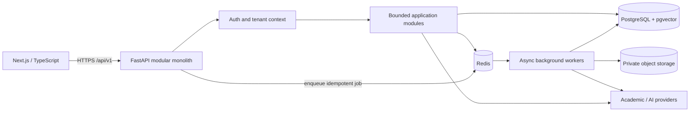
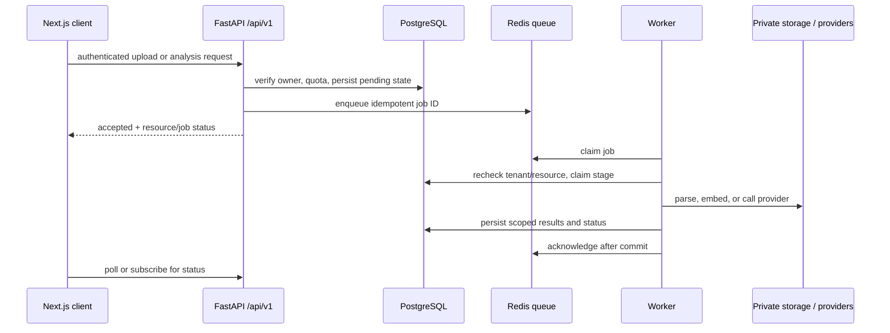

# ResearchNest v2 System Architecture

## Goals and constraints

ResearchNest v2 evolves the current flat FastAPI application into a modular monolith with independently testable domain modules and separately runnable asynchronous workers. The first release can deploy as a small number of services while keeping bounded contexts and ownership boundaries explicit. The web client is Next.js/TypeScript. PostgreSQL is the source of truth, pgvector provides vector similarity, and Redis provides worker coordination, rate/usage coordination, and carefully scoped caching.

The existing application is a synchronous layered backend under `backend/app/{routers,services,repositories,models}`. v2 moves features behind `/api/v1`, separates global academic metadata from personal research state, and moves long-running document/AI processing off the request path. Existing Markdown documentation remains historical context; this document defines the target, not current implementation.

## Logical topology



## Backend module boundaries

Organize backend capabilities by domain rather than placing all routes or ORM classes in a shared flat package. A proposed layout is:

```text
backend/app/
  api/v1/                 # router assembly and versioned HTTP adapters
  modules/
    auth/                 # accounts, verification, sessions, security events
    users/
    papers/               # global metadata and user library references
    collections/
    documents/            # uploads and processing state
    annotations/
    research_projects/
    writing_documents/
    conversations/
    rag/                  # retrieval policy and citation construction
    ai/                   # provider orchestration and usage controls
    arxiv_client/         # academic-provider adapter
  platform/
    config/ database/     # async sessions, transaction boundaries
    cache/ jobs/ storage/ security/ observability/
workers/                  # worker entry points and job registration
```

The exact file decomposition can evolve, but each module owns its API schemas, use cases, repository interfaces/implementations, and domain-specific persistence. Shared platform code should stay small. A module must not reach into another module's tables or private repository internals; it calls a documented application interface or consumes an event.

Keep transport schemas separate from ORM mappings. Use Pydantic v2 models for request/response validation, SQLAlchemy 2.0 typed mappings with async sessions for request-scoped database work, and Alembic for schema changes. Routers authenticate and validate, then call application services. Repositories encode explicit query scope. External academic/AI systems sit behind adapters with timeouts, bounded retries, typed results, and secret-safe error handling.

## Request and background-job flow

Short operations use a normal authenticated request transaction: resolve the principal/session, establish tenant context, validate the request, execute the module use case, and return a response. Every private query is owner-filtered in SQL and, where configured, additionally protected by PostgreSQL row-level security.

Long tasks such as PDF extraction, page/chunk generation, embedding, large provider searches, and document analysis are accepted as durable work requests. The API validates ownership and quotas, persists a job/state transition, and enqueues an idempotent job through Redis. A worker claims the job, revalidates ownership/resource scope, performs bounded stages, writes status/results transactionally, and retries safely. Job payloads carry stable resource IDs and tenant context, never bearer tokens or raw session secrets. Workers acknowledge only after durable state updates; retries and duplicate delivery must not duplicate charges or data.



## API and web client

All product HTTP endpoints are rooted at `/api/v1`. Keep health/readiness and operator-only diagnostics separate from tenant APIs; avoid exposing development/demo endpoints in production. Publish an OpenAPI schema and generate or validate TypeScript client types against it. Use consistent pagination, error envelopes, request IDs, and deprecation/versioning practices.

The Next.js/TypeScript frontend calls the API over HTTPS. Tokens and session credentials must not be placed in URLs or browser logs. Prefer secure, HttpOnly, SameSite cookies for browser session/refresh credentials where the deployment's CSRF design supports them; protect state-changing cookie-authenticated requests with CSRF controls. Keep UI authorization checks for usability only; the API is authoritative.

## Storage, reliability, and observability

- PostgreSQL owns durable domain state and vector rows; Redis is not a source of truth. Define transaction ownership and outbox/idempotency behavior for work dispatched alongside database writes.
- Store uploaded source files in private object storage, with opaque keys and authorization mediated by the application. Keep object metadata and processing state in PostgreSQL.
- Bound provider timeouts, retries, payloads, worker concurrency, and job age. Use dead-letter/error states, safe replay, and operational metrics without logging private content.
- Emit structured logs, traces, and metrics with correlation/job IDs. Exclude credentials, full prompts, paper/document content, and tenant-sensitive payloads from routine telemetry.
- Separate readiness from liveness: readiness verifies dependencies needed to serve requests; liveness does not start expensive downstream work.

## Deployment topology

Initially deploy the Next.js application, FastAPI API, worker process, PostgreSQL, and Redis as separate runtime roles with shared versioned configuration. Scale workers independently from API instances. Apply Alembic migrations once through a controlled deployment step, not on every API startup. Use TLS, private networking, least-privilege identities, backups, and restore drills for durable stores.

## Architecture decisions to lock in during Phase 01

- Select and pin the Redis worker framework/queue semantics and document delivery guarantees.
- Decide private object-storage provider, file lifecycle/retention, and malware scanning integration.
- Define browser token transport and CSRF/session renewal behavior.
- Define pgvector dimensions, embedding model/version metadata, and re-embedding strategy.
- Define PostgreSQL RLS roles and transaction-local tenant context, then test pool reuse.
- Resolve the migration history issue before relying on an empty-database deployment path.
